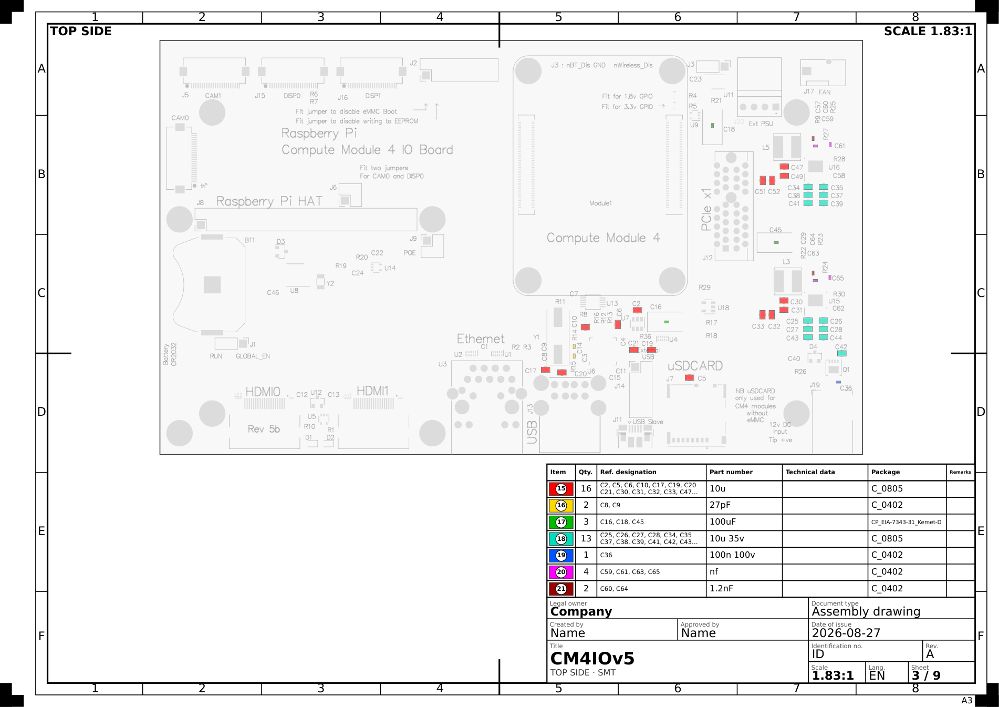
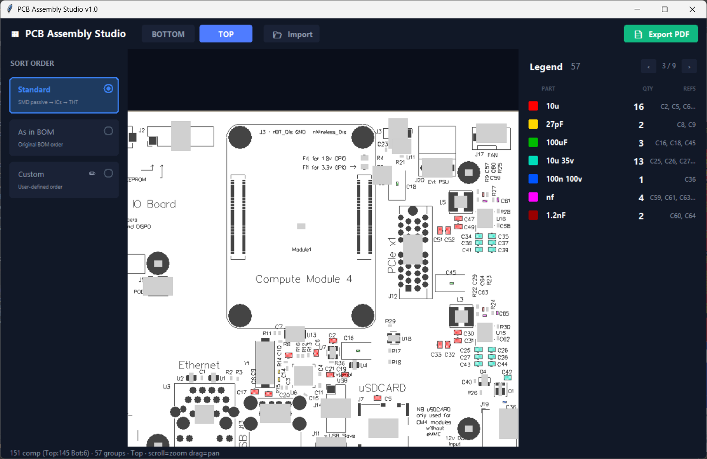

# PCB Assembly Studio

Turn Altium or KiCad outputs — Gerber, BOM, Pick & Place and NC drill files — into multi-page **PCB
assembly drawings**. Interactive board viewer, print-ready PDF export.

**100% offline.** Everything is parsed on your machine. No uploads, no network calls.



*One A3 sheet of the exported PDF — ISO 5457 frame, ISO 7573 parts list, ISO 7200
title block. Each group gets a colour, so every 12K resistor on the board is
found by looking instead of reading designators.*

---

## 🚀 Run from source

**Source distribution only for now; Python is required.** Standalone Windows
executables are not currently offered: unsigned builds can be blocked by Windows
Smart App Control. Code signing and a supported binary distribution channel are
still pending. Do not disable Windows protection to run this application.

1. Install [Python 3.10+](https://www.python.org/downloads/) — tick **"Add Python to PATH"**
2. Green **Code** button above → **Download ZIP** → right-click the ZIP → **Properties** → tick **Unblock** → unzip
3. Double-click **`run.bat`**

> Don't skip the Unblock. Windows silently refuses to run `.bat` files unpacked
> from a downloaded ZIP — `run.bat` would just do nothing when you click it.

`run.bat` installs `matplotlib` and `gerbonara` the first time, then starts the app.
By hand:

```
python -m pip install matplotlib gerbonara
python pcb_assembly_studio.py
```

Optional extras: `openpyxl` for `.xlsx` BOMs, `ezdxf` for DXF, `tkinterdnd2` for
drag-and-drop.

---

## 📋 Input Files

| File | Format | Export from Altium | Required |
|------|--------|--------------------|----------|
| **Pick & Place** | `.txt` `.csv` `.pos` | File → Assembly Outputs → Generates pick and place files | ✅ |
| **BOM** | `.txt` `.csv` `.xlsx` | Reports → Bill of Materials → Export | ✅ |
| **Gerber + NC drill ZIP** | `.zip` | Gerber Files + NC Drill Files in one archive | Optional; drill data needed for geometry-based THT detection |

**Automatic recognition is not guaranteed.** Review mounting types, inferred
placement areas and installation order before using the drawings. A successful
import does not certify that every component was identified correctly.

For THT detection from geometry, supply **plated drill coordinate files plus
Gerber top and bottom copper**, exported from the same board revision with the
same origin and units as Pick & Place. Drill files alone do not identify component
references. `.DRR` and `.LDP` reports do not replace drill coordinate files.
Without these inputs the app can still use explicit mounting text and package
hints, but cannot confirm THT from hole geometry.

Put plated and non-plated NC drill coordinate files (`.txt`, `.drl`, `.xln`,
`.exc`, `.tap`) into the **same ZIP as the Gerber layers**, then load it once
under Gerber + NC drill ZIP. Files in subfolders are also found automatically;
no separate drill import is needed. Gerber-only archives still open, with a
warning that hole-based THT detection is unavailable. A malformed drill file is
reported without preventing the Gerber artwork from loading. Replacing or
removing the archive clears its previous drill evidence. Earlier projects with
separate drill links remain readable.

Plating must be declared in the file; unknown plating
is not assumed to be plated. Units and coordinate format must be readable without
guessing. Separate plated/non-plated exports are recommended.

The conservative detector looks for centered, symmetric rows or rectangular
groups of plated holes with matching annular pads on both outer copper layers.
Shared or ambiguous groups are rejected. Small holes below 0.5 mm, groups beyond
12 mm from the placement center, slots, off-center origins, unusual pin patterns,
hybrid parts and dense layouts may need manual classification. These limits are
deliberate safeguards, not a universal definition of THT. Hole diameter alone is
never considered proof that a hole is a component lead or a via. Mechanical NPTH
holes are not classified as THT.

Gerber paste layers (`.GTP` / `.GBP`, or KiCad F/B Paste) can provide an estimated
**placement-area envelope for sorting**, not the actual body dimensions or height.
Automatic estimates require unambiguous pad assignment and at least two agreeing
instances of the same footprint. Unique, incomplete, asymmetric or crowded
footprints may remain unknown. Do not expect a larger component's whole pad group
to belong to its nearest Pick & Place center. No coordinate alignment/mirroring
is guessed automatically. Unsupported/failed geometry reads are listed under
Geometry warnings in Edit installation.

The app does not query manufacturer documentation or a parts catalogue. Manual
mounting and size overrides take priority and are saved in the project. Use
**Edit installation…** to review the mounting source (`file text`, `inferred`,
`name hint`, or `unconfirmed`), correct sizes, and Exclude / Include non-component
records. Source exports are never modified.

**Pick & Place** — Altium fixed-width or CSV, KiCad `.pos`. Simple
(`Designator Layer X Y Rotation`) or extended with Comment/Footprint/Description.
Millimeters or mils, auto-detected.

**BOM** — needs **Comment, Description, Designator, Layer**. Two optional
columns are worth exporting:

- **Footprint** (also read as *Package* or *Pattern*) sharpens the drawn part
  outlines, since a name like `USON-10_2.5x1.0mm_P0.5mm` states the body size
  outright.
- **Part Number** (also *MPN*) fills the Part number column. Placeholders like
  `Generic` or Altium's `[NoParam],` prefix are ignored, and the Comment is
  used when no real number is there.

Technical data comes from Description regardless of length. PDF cells wrap text
and reduce the font when needed; text that still cannot fit at the minimum size
ends with an ellipsis. The complete description stays in the imported data. Tab, `;` or `,`
delimiters auto-detected. DNI / DNP / "Do not place" parts are listed separately
with a ⛔ marker and get their own PDF pages; Russian markers
("НЕ УСТАНАВЛИВАТЬ", "НЕ СТАВИТЬ") count too, and cp1251 files decode correctly.
A Comment of exactly `nf` or `dnf` counts as not-fitted as well — the whole
field has to be that word, so `100 nF` and `1.2nF` stay on the board.

**Gerber ZIP** — layers by extension: `.GTO`/`.GBO` silkscreen, `.GTS`/`.GBS`
solder mask, `.GM1`–`.GM4`/`.GKO` outline. Cyrillic filenames inside the ZIP are fine.

---

## 🖥️ What You Get



**Viewer** — scroll to zoom, drag to pan. Gerber artwork as the background, solid
colored component highlights, pin-1 markers on ICs, bottom layer auto-mirrored.

**Legend** — 7 groups per page. Hover a row to light those parts up on the board,
hover REFS for the full designator list. Click a row to focus it: the rest of the
board fades almost to white and parts too small to spot get a ring around them.
Click the row again, click the board or press Esc to clear.
Rows show Part number and Technical data from the same fields as the PDF, with
references below. Hover the part number or technical text to read the full value.
Gerber placement-area estimates affect sorting only; they do not split otherwise
identical BOM components into separate groups. Board sides, installation stages,
different footprints and explicit manual edits still remain separate.

**Files** — the ← Files button returns to the file screen, where each loaded file
has a ✕ to remove it. Replacing a wrong BOM no longer means restarting the app.

**Sort order** — Smallest first sorts all component types together by estimated
occupied area, then longest dimension: 0402 resistors and capacitors precede 0603
parts. Footprints take priority over description/value text. Dimensions are
estimates from package names, not measurements or component height. Where a
repeatable Gerber paste envelope is available, that estimated placement area
is used for sorting instead; it does not overwrite the drawn body dimensions. Unrecognized
sizes are marked Unknown in Edit installation and sort after recognized sizes;
placeholder drawing dimensions are never treated as known body sizes. Manufacturer
inductor series numbers such as WE-PD 1210 are not interpreted as chip size 1210. As in
BOM and custom prefix ordering are also available.

**Assembly preview** — choose SMT or THT / Manual and Bottom or Top. Export PDF
writes Bottom SMT, Top SMT, then THT / Manual (both sides), with independent
sheet numbering for each of these three sections. SMT and THT never share a
sheet; DNI parts have separate sheets. Empty sections are omitted.

**Edit installation…** — select individual parts (Ctrl/Shift for multiple),
assign SMT, THT or Manual, or restore Auto detect. A heavy bottom-side SMD part
assigned Manual moves to the final THT / Manual section while retaining its
physical board side. Earlier / Later changes the order within each side and
stage; stage boundaries always take priority. Apply commits the edits, Cancel
discards them. Reset manual order restores the selected sorting mode. Explicit
technology and package keywords detect THT; a generic connector name alone
does not prove its mounting type, so review uncertain parts here. Installation
overrides and manual order are saved in `.pcbasm` projects.

**Part number and Remarks** — Edit installation shows separate Part number,
Technical data and Remarks columns. Double-click a Remarks cell or select parts
and choose Edit remarks to enter a multiline note. Save remark updates the table;
Apply commits all editor changes, while Cancel discards them. Clear remarks
removes notes from the selected parts. Notes are saved in the project and appear
in PDF Remarks alongside automatic Key/DNI labels, including on custom pages.
Different notes intentionally create separate rows, so a note applies only to
the specified components. The PDF designation column is one third narrower;
Remarks gains the same width. Reference lists, part numbers, technical data and
remarks can wrap and shrink within their cells. Very long text is marked with
an ellipsis after the minimum font size is reached.

**Exclude / Include** in Edit installation removes a selected reference from all
assembly lists, custom pages, PDF tables and component overlays; Include restores
it. The entry remains visible as Excluded in the editor, so it can be restored.
Gerber artwork itself is not edited. This is separate from DNI, which documents
a real component that is intentionally not fitted.

**Set size / Auto size** — enter two positive dimensions in millimetres for the
selected parts, or restore package detection. Dimensions, exclusions and mounting
overrides are saved in the project; source BOM and Pick & Place stay unchanged.
If a previous project has a manually frozen sequence, Reset manual order restores
the selected sorting mode so improved package detection can reorder those parts.

THT describes through-hole technology; Manual requests late hand installation,
including SMD parts. Both currently share the final THT / Manual section.

**Custom pages** — a drawing of just the parts you list, for rework or a second
pass after test. **+ New** under *Pages* takes a name and designators separated by
commas, spaces or new lines; `R7-R12` is a range. The dialog counts the parts it
found on each side and names the ones that are not in the drawing. Parts keep the
grouping, sort order and colour rules of the full drawing. A project can hold any
number of pages; Export PDF writes the open page to a file of its own,
`Assembly drawing for <title> - <page>.pdf`, with the page name in the view
caption and the title block.

**Projects** — 💾 Save (Ctrl+S) writes a `.pcbasm` file with the loaded files, sort
order, title block and sheet settings, and custom pages. The date of issue is not
saved: it belongs to each issue. Files are stored as links, relative to the
project file, so a folder moved or copied as a whole still opens — keep the
project next to the Altium outputs. A BOM re-exported to the same place is picked
up the next time the project is opened. When a file cannot be found, the app asks
where it went. Open a project from the file screen with **Open project…**; the
window asks before closing with unsaved pages or changes.

**PDF** — a proper ISO technical drawing (see below), 7 colors per page (red,
yellow, green, cyan, blue, magenta, dark red), board artwork from Gerber.
Export shows an animated progress window with completed page count and elapsed
time. The destination PDF is published only after the entire export finishes;
a failed export preserves an existing PDF at the same path.

---

## 📐 ISO Drawing Format

Every exported sheet is laid out as a technical drawing, not a screenshot.

| Element | Standard |
|---------|----------|
| **Sheet** — A4 / A3 / A2, landscape or portrait; 20 mm filing margin on the left, 10 mm elsewhere | ISO 5457 |
| **Grid reference border** — 50 mm zones lettered A… down and numbered 1… across, plus centring and trimming marks | ISO 5457 |
| **Title block** — 180 mm wide, bottom right: legal owner, title, identification no., revision, date of issue, created/approved by, document type, scale, language, sheet *n* / *m* | ISO 7200 |
| **Parts list** — item, ref. designation, part number, technical data, qty, remarks | ISO 7573 |
| **Item numbers** — encircled numerals on the colour key | ISO 6433 |
| **Line widths** — 0.7 / 0.5 / 0.35 / 0.25 mm; **lettering** — 1.8 / 2.5 / 3.5 / 5 mm | ISO 128-20, ISO 3098 |
| **Scale** — a real one from the 2 / 5 / 10 series, printed as `SCALE 1:1` | ISO 5455 |

**The scale is real.** The page is exactly 210 × 297 mm (or 420 × 297, …) and the
board is drawn at the chosen ratio, so a sheet printed at 100 % can be laid next
to the board and measured. `auto` picks the largest standard scale that fits;
`fit` fills the view area instead and reports the resulting intermediate ratio.

Two deliberate departures from the letter of the standards:

- ISO 5457 allows A4 only upright and A3–A0 only landscape. The export dialog
  offers both orientations for every size, and says so when you deviate.
- ISO 7573 puts the parts-list header against the title block, which means
  reading the items upward. The header is at the top here and the items read
  downward, the way anyone actually reads a table.

The **Drawing setup** dialog on export sets the sheet, the scale mode and the
title-block fields, and shows the resulting sheet size and scale as you change
them.

---

## ⚠️ Limitations

- Automatic mounting recognition is not guaranteed, even with Gerber and drill files. Review every inferred or uncertain result.
- Body sizes remain estimates from description/package text. Gerber paste envelopes estimate placement area for sorting, not body size or height.
- Geometry-based THT detection requires plated drill coordinates and both outer copper layers. Missing, ambiguous or unsupported geometry needs manual review; DRR/LDP reports are insufficient.
- Pin-1 markers come from Pick & Place rotation. Unusual library footprint orientation can put the marker in the wrong corner — check against your design.
- DWG needs ODA File Converter. Export DXF from Altium instead, or use a Gerber ZIP.

---

## 🌍 Drawing Language

The GUI is English-only, but text **inside the generated PDF** is localisable.
Set `LANG = "ru"` in `pcb_assembly_studio.py` for bilingual Russian/English table
headers. Only the drawing changes.

---

## 📝 Changelog

**v1.5** — Editable per-component Remarks saved in projects, with distinct
Part number and Technical data columns in the installation editor. PDF Remarks
gains one third of the former designation-column width. Table text wraps and
shrinks to fit; different notes produce separate component rows. Older projects
still open; newly saved projects require v1.5 to preserve remarks.

**v1.4.4** — Preview legend and installation editor use the PDF Part number field;
technical text has a two-line preview and full hover text. Partial or slightly
different Gerber paste-area estimates no longer split identical BOM components.

**v1.4.3** — Technical data no longer disappears for descriptions of 60 or more
characters. The PDF displays the prefix that fits, with an ellipsis and no font
shrinking; the full imported description is preserved.

**v1.4.2** — PDF export progress window with animation, page count and elapsed
time; background work reports progress through a thread-safe queue. Finished
PDFs replace the destination atomically, preserving previous files on failure.

**v1.4.1** — One ZIP import for Gerber layers and NC drill coordinates;
separate drill drop zones removed. Legacy project drill links still open.

**v1.4** — Conservative geometry evidence from Gerber paste/outer copper and
plated/non-plated Excellon files. Mount-source indicators, inferred placement-area
sorting and explicit review warnings. Per-model manufacturer size rules removed;
manual settings keep priority. Drill links are saved in projects. Exclude / Include
keeps non-component records out of all assembly lists and PDF component overlays.
Opens older projects; newly saved projects require v1.4 to preserve drill links.

**v1.3.1** — POWERMITE and 3224W size recognition, pin-header / jumper and
DIP-switch mounting detection, Unknown size indicators, saved dimension overrides,
and reversible exclusions. Opens earlier projects; newly saved projects require
v1.3.1 to preserve these settings.

**v1.3** — Installation stages: Bottom SMT, Top SMT, then THT / Manual,
with separate sheet numbering. Size-based sorting across all component types;
footprints retained from Pick & Place. Individual mounting overrides and manual
ordering, shared stage preview / PDF planning, and saved installation settings.
Opens older projects; saved projects require v1.3 to preserve installation edits.

**v1.2** — Custom pages: a drawing of only the designators you type in, with
ranges, exported to its own PDF. Projects: the loaded files, settings and pages
save to a `.pcbasm` file that links to the files relative to itself. The file
screen's Open project button is now **Continue**, next to **Open project…** for
saved projects.

**v1.1.1** — Click a legend row to focus that group: the board fades out around it
and small parts get locator rings. The mouse wheel zooms the right way round. A
← Files button returns to the file screen, where loaded files can be removed and
replaced; Import from the workspace now refreshes the board (it silently did
nothing before). Components are drawn solid instead of translucent, with an edge
in a darker shade of their own colour kept thin on small parts, so groups stay
distinguishable in print. The parts list drops the Package column and moves Qty.
next to Remarks. The title defaults to the board name without Altium's
"Pick Place for" prefix, and Export PDF suggests "Assembly drawing for <title>"
as the file name.

**v1.1** — ISO-format drawings. Sheet size (A4/A3/A2) and orientation are now
chosen on export; the sheet follows ISO 5457 (border, frame, grid reference
zones, centring and trimming marks), the title block follows ISO 7200, the
legend became an ISO 7573 parts list, and the board is drawn at a real ISO 5455
scale instead of being stretched to fit. The parts list gained **Part number**,
**Technical data** and **Package** columns fed by the BOM, and the title block
gained fields for legal owner, identification number, date of issue and
approver.

**v1.0** — Initial public release
